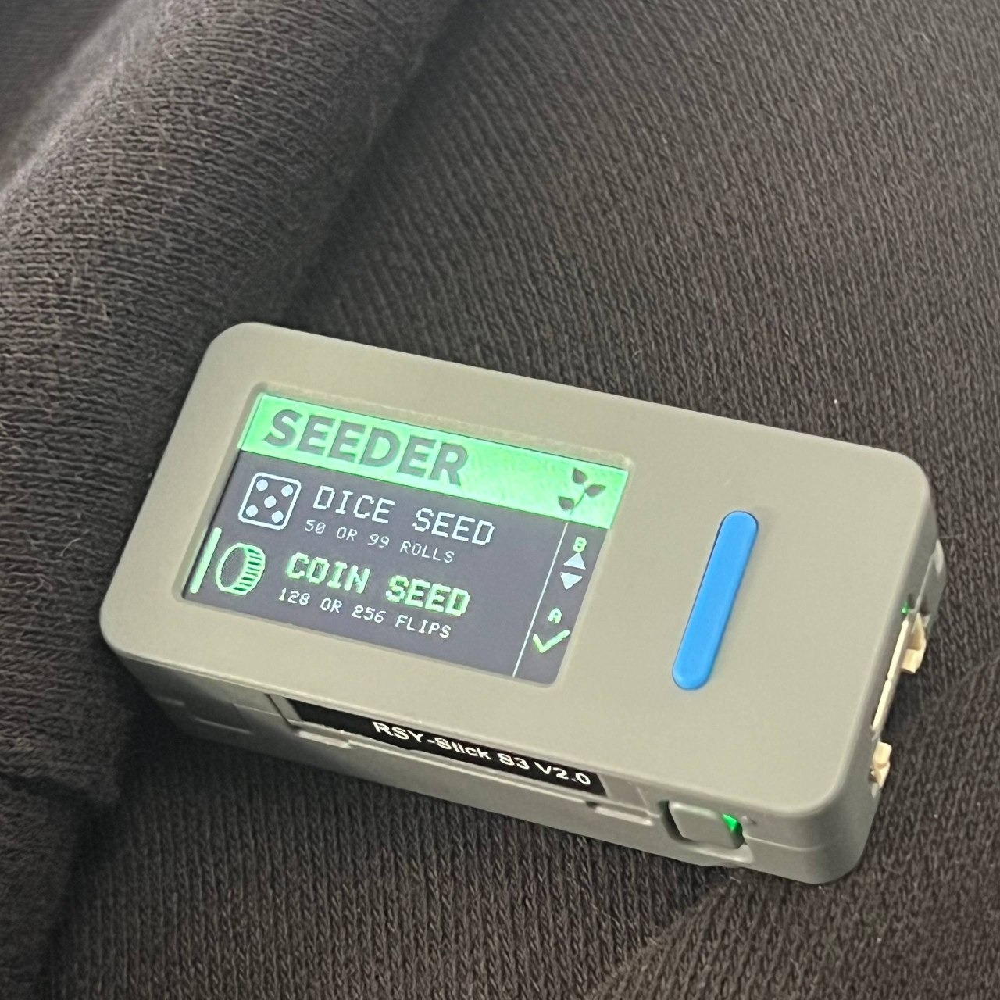
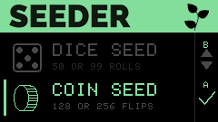
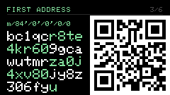

# Seeder on M5Stack StickS3

This manual covers the **M5Stack StickS3, SKU K150**, running this fork's rectangular Seeder interface. The reference is [BitMaker and Lunaticoin's Seeder v2.2.0](https://github.com/BitMaker-hub/Seeder/tree/ba6e9ebe226222cbb04415a635a934eeae372dab); the original MIT license and credits are retained. The tested clean firmware identifies itself as `2.2.0-sticks3-dev`, commit `38de080`.

[Project hub](readme.md) · [Shared use guide](docs/using-seeder.md) · [Full flashing guide](docs/flashing.md) · [Security](SECURITY.md)

[Hardware & buying](#hardware-and-buying) · [Install](#install-short-version) · [Buttons](#buttons) · [Generate a seed](#generate-12-or-24-words) · [Page reference](#review-every-page) · [Troubleshooting](#troubleshooting)

## Hardware and buying

| Item | Required model / specification |
| --- | --- |
| Product | M5Stack **StickS3**, **K150** |
| Controller | ESP32-S3-PICO-1-N8R8 |
| Memory | 8MB flash; 8MB octal PSRAM |
| Display | 1.14-inch ST7789P3 LCD, physically 135×240 pixels; Seeder uses 240×135 landscape |
| Input | Front A/KEY1 (GPIO11), side B/KEY2 (GPIO12), separate power key |
| USB / battery | USB-C; manufacturer-listed 250mAh built-in battery |
| Motion hardware | BMI270 six-axis accelerometer/gyroscope; unused by Seeder |
| Audio hardware | MEMS microphone, ES8311 codec and amplified speaker; unused by Seeder |
| Other hardware | Infrared transmit/receive, Grove/Hat2 expansion interfaces; no accessory needed |

Check the [official hardware documentation](https://docs.m5stack.com/en/core/StickS3) and buy from the [M5Stack official K150 product page](https://shop.m5stack.com/products/m5sticks3-esp32s3-mini-iot-dev-kit). **M5StickC, StickC Plus and StickC Plus2 use different hardware and are not this target.** A USB-C data cable and a computer are sufficient for installation; Seeder needs no network connection during use.

The hardware has radios, audio and sensors, but this application does not initialize Wi-Fi/Bluetooth or use its audio/sensor features. Battery capacity is a manufacturer specification, not a runtime estimate. Battery operation, power-key behavior and USB power interactions have not completed Seeder-specific physical qualification; no battery-life figure is published.

## What the current screen looks like



*The device photograph shows an earlier green interface. The current rectangular build uses blue accents, matching the blue button; the software screenshots below show that appearance.*

| Menu | First receiving address | CompactSeedQR |
| --- | --- | --- |
|  |  |  |

*Production-code software renders using public test data. They establish the intended pixel layout, not physical camera-scanning performance.*

## Install: short version

1. Confirm the model is **K150 StickS3**. [Download a matching successful Actions artifact or build from public source](docs/flashing.md#get-binaries-or-build-locally); this fork has no tagged binary release yet. Use the complete merged image and its matching checksum.
2. Connect with a USB-C **data** cable. Close other serial tools and select this device's port.
3. Write the **merged image at `0x0`**, verify it before application startup, then reset. Follow the commands in [the full flashing guide](docs/flashing.md#sticks3-complete-image).
4. Test the menu, input and export flow with a public test seed.

The optional [browser installer](https://xn--sg8hhb.ws/flasher/) is planned; use the terminal procedure until it is live and offers the exact StickS3 target. The independent build and esptool instructions do not depend on that site.

The exact previously tested clean file is `seeder-sticks3-38de080-merged.bin`; its checksum is in the full guide. Current CI artifacts and local rebuilds are identified separately and must not be described as that exact installed binary merely because they share a firmware version.

Flashing replaces the installed application and its flash layout. An application-only `firmware.bin` belongs at `0x10000`; it is **not** the complete image and must not be written at `0x0`.

## Buttons

Find **A** on the front and **B** on the side. The separate power key is not either Seeder input.

| Screen | Side B / MOVE | Front A / OK |
| --- | --- | --- |
| Coin/dice menu | Toggle Coin / Dice | Select highlighted mode |
| Word-count menu | Toggle 12 / 24 | Start input |
| Coin entry | Record Heads = 1 | Record Tails = 0 |
| Dice entry | Cycle the displayed value 1→2→…→6→1 | Record displayed roll |
| Generated pages | Next page, wrapping at the end | Previous page, wrapping at the beginning |
| Exit / Write It Down | Tap: first mnemonic page | Tap: Watch Only; hold about **1.2 seconds**: clear application fields and return to main menu |

Ordinary taps take effect on release. During coin/dice entry, holding A for **three seconds** discards the whole unfinished entry. A warning appears after about 1.2 seconds; releasing during that warning cancels the discard and does not add a coin flip or die roll. This three-second input-discard action is different from the shorter Exit action.

The manufacturer documents one power-key click as power on/reset and two clicks as power off. [Download mode](https://docs.m5stack.com/en/core/StickS3#download-mode) uses a power-key hold until the green LED blinks, followed by release. These hardware functions are separate from A/B navigation. This port adds no automatic sleep or inactivity timeout.

## Generate 12 or 24 words

1. At the main menu, use B to choose **Coin** or **Dice**, then A to select.
2. Use B to choose **12** or **24** words, then A to begin. Each new mode selection starts with 12 words selected.
3. Supply each physical result using the controls below. There is no individual undo/edit command; if a result is entered incorrectly, hold A for three seconds to discard the entry and start again.
4. The final required input automatically opens the generation screen, then the first word page. No extra confirming flip or roll is needed.

| Mode | 12 words | 24 words | How to enter |
| --- | --- | --- | --- |
| Coin | 128 flips | 256 flips | Flip a coin; tap B for Heads or A for Tails |
| Dice | 50 rolls | 99 rolls | Roll a six-sided die; tap B until its face matches, then A to record |

The selected die face returns to **1** after every recorded roll; the screen shows the three most recent recorded rolls. Tapping B to choose a face does not record it. The physical randomness comes from your coin or die, not an internal device RNG. [The shared guide](docs/using-seeder.md#how-the-input-becomes-a-seed) explains the exact calculation.

## Review every page

Tap **B** to follow this order; tap **A** to retrace it. The page cycle wraps, so neither tap alone clears the seed.

| Page | What it contains / what to do |
| --- | --- |
| Mnemonic words 1–12 | Numbered BIP39 words; write them in order |
| Mnemonic words 13–24 | Present only for a 24-word seed; continue numbering |
| First Address | Mainnet native SegWit receiving address at `m/84'/0'/0'/0/0`; text plus QR. The QR uses equivalent uppercase Bech32 text. |
| Entropy (hex) | The original 16 or 32 entropy bytes used to derive the words; use only an offline independent tool to verify |
| Export | Space-separated mnemonic words in a text QR; contains the complete seed |
| Compact QR | The original 16/32 entropy bytes in binary CompactSeedQR; contains the complete seed in a different format |
| Watch Only | Bare BIP84 account **zpub** QR for `m/84'/0'/0'`, plus the master fingerprint shown as text |
| Exit / Write It Down | Reminder to secure the backup; hold A about 1.2 seconds to leave |

The receiving address is only the first address of one account, not a complete watch-only wallet. Watch Only can expose this account's wallet activity but cannot sign a spend. The zpub QR is a bare account key, not a complete output descriptor; the shown fingerprint is **not** embedded in that QR. [Payload details and wallet compatibility](docs/using-seeder.md#pages-and-qr-payloads) explain these distinctions.

Export and Compact QR allow recovery/spending. Scan them only with a compatible **offline signing device**; keep them away from online phones, screenshots and cloud backups. CompactSeedQR requires a compatible binary decoder; an ordinary text scanner may display nothing useful. Physical SeedSigner camera scanning of this exact screen still needs validation.

## Leave or restart

- **During input:** hold A continuously for three seconds. Release during the visible warning to keep the unfinished entry.
- **After generation:** navigate to Exit and hold A for about 1.2 seconds. This clears application-owned seed, entropy, key/address and capture fields and returns to the mode menu. There is no three-second Exit countdown on this target.
- **Keep reviewing:** tap A from Exit for Watch Only, or B for the first word page.

Seeder does not intentionally persist the seed. Exiting is not a verified complete RAM scrub: library, stack and display copies have not all been proven erased. A restart loses the application's current workflow; do not rely on it as a seed backup. Read [Security](SECURITY.md) for the limits.

## Troubleshooting

| Symptom | Check / action |
| --- | --- |
| No serial port or connection | Use a data cable, another USB port, and close serial monitors. Enter the official download mode with the separate power key. |
| Black screen after flashing | Confirm K150, correct merged image and `0x0` address. A raw app at `0x0` cannot replace the complete image. See [recovery](docs/flashing.md#connection-and-recovery). |
| Whole merged-image verification fails after a normal boot | NVS initialization and the M5GFX board hint change expected mutable bytes. Verify the original bootloader/table/app segments as described in the flashing guide; do not ignore immutable-segment mismatches. |
| Navigation seems reversed | Generated pages use B **forward**, A **back**. A accepts only in menus/input. |
| Wrong die/coin result was recorded | There is no per-result undo; discard the unfinished entry with the three-second A hold and restart. |
| QR does not scan | Try the correct export format in a compatible offline device, adjust distance/angle and reduce reflections. Compare all words manually if needed. Host decoding tests do not guarantee every physical camera. |
| Seed/address disagrees with an independent wallet | Check word order, empty BIP39 passphrase, mainnet BIP84 and `m/84'/0'/0'/0/0`. If an independently checked result still differs, stop using that seed with funds. |

## Build and validation

From the repository root, using Python 3:

```sh
python3 -m venv .venv
.venv/bin/python -m pip install platformio==6.2.0 esptool==4.9.0
.venv/bin/pio run -e sticks3
```

Output: `dist/seeder-sticks3-merged.bin` for `0x0`; `.pio/build/sticks3/firmware.bin` for `0x10000`. A source rebuild is a new artifact; the tested clean prebuilt checksum does not automatically apply to it. See [full build/flash instructions](docs/flashing.md).

The clean `38de080` image was flashed, verified in its entirety through the ROM loader before startup, and restarted. The receiving-address screen has physical photographic evidence. Independent host checks cover 78 calculation vectors, 19 CompactSeedQR encoder round trips, native QR/module geometry and production-backend address/text rendering. These are separate from physical button-flow, camera, battery and signing-device checks, which remain incomplete. Complete RAM erasure and an independent security audit are not established.

[Original MIT license](LICENSE) · [Dependency notices](THIRD-PARTY-NOTICES.txt) · [Fork differences](docs/fork-differences.md) · [Official M5Stack hardware guide](https://docs.m5stack.com/en/core/StickS3)
