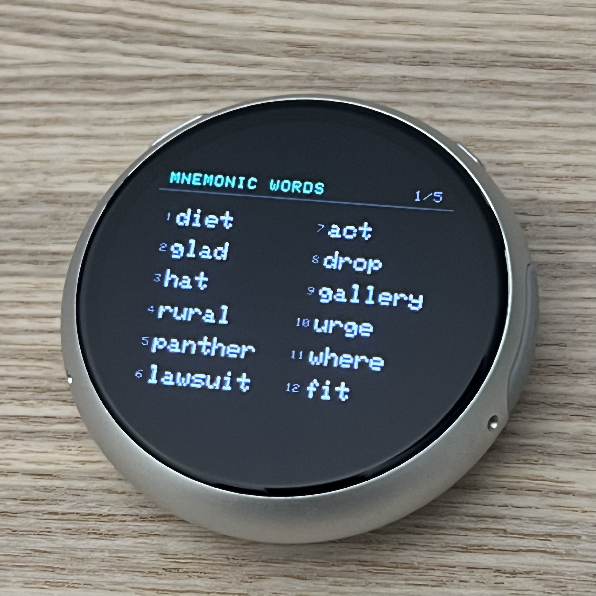
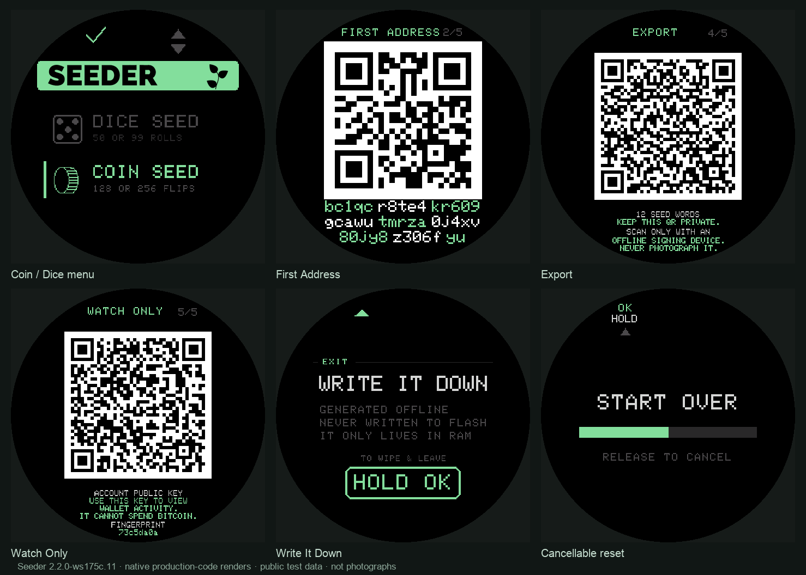

# Seeder on Waveshare AMOLED 1.75C

This manual covers **ESP32-S3-Touch-AMOLED-1.75C**, with current source version `2.2.0-ws175c.11`. It adapts [BitMaker and Lunaticoin's Seeder v2.2.0](https://github.com/BitMaker-hub/Seeder/tree/ba6e9ebe226222cbb04415a635a934eeae372dab) to the circular display, retaining their seed calculations, graphics language, MIT license and credits.

[Project hub](readme.md) · [Shared use guide](docs/using-seeder.md) · [Full flashing guide](docs/flashing.md) · [Security](SECURITY.md)



*Test seed: 50 dice rolls of 1.*

[Hardware & buying](#hardware-and-buying) · [Install](#install-short-version) · [Buttons](#orientation-and-buttons) · [Generate a seed](#generate-12-or-24-words) · [Page reference](#review-every-page) · [Troubleshooting](#troubleshooting)

## Hardware and buying

| Item | Required model / specification |
| --- | --- |
| Product | Waveshare **ESP32-S3-Touch-AMOLED-1.75C** |
| Controller / memory | ESP32-S3R8; 32MB flash; 8MB PSRAM |
| Display | Round 1.75-inch CO5300 AMOLED; 466×466 pixels |
| Enclosure | CNC-machined aluminum alloy enclosure |
| Inputs | Two buttons: small BOOT and larger PWR; touch hardware is present but disabled in Seeder |
| Connection | USB-C; battery support according to the purchased variant |
| Touch / motion | CST9217 capacitive touch and QMI8658 six-axis IMU; not used for input or entropy |
| Audio hardware | Dual microphones through ES7210, ES8311 codec and speaker; unused by Seeder |
| Power management | AXP2101 charging/power-management IC; factory configuration retained |

Use the [official Waveshare hardware documentation](https://docs.waveshare.com/ESP32-S3-Touch-AMOLED-1.75C) and [correct-model shop page](https://www.waveshare.com/esp32-s3-touch-amoled-1.75c.htm). The documented **SKU 33691 includes a battery**; **SKU 33692 does not**. Check the selected battery option before ordering. Follow Waveshare's instructions for a compatible battery and installation; this guide does not prescribe a substitute cell.

The **C suffix is essential**. The non-C ESP32-S3-Touch-AMOLED-1.75 has different wiring and is unsupported by this firmware. The guarded installer also requires the C board's **32MB flash and complete seven-partition factory map**. A similar screen or enclosure does not establish compatibility.

Seeder does not initialize Wi-Fi/Bluetooth and does not use touch or audio. The board's battery support is a hardware feature; Seeder-specific battery operation and runtime have not been measured. No battery-life claim is made.

## Install: short version

1. Confirm the **1.75C / 32MB** model. [Get a matching successful Actions artifact or build from public source](docs/flashing.md#get-binaries-or-build-locally); this fork has no tagged binary release yet. Use this target's **application-only** file.
2. Connect a USB-C data cable and identify the board's serial port and MAC.
3. Run the project's **guarded Waveshare installer**. It checks identity and the factory map, verifies a private backup, then writes and verifies only the app at **`0x200000`**.
4. Let it reset and test the complete workflow with public test inputs.

Use the **[browser flasher](https://xn--sg8hhb.ws/flasher/)** in desktop Chrome/Edge: select **Waveshare AMOLED 1.75C → Seeder**, follow the flashing-mode instructions, prepare and save the recovery file, then install. The installer requires the exact factory partition map and writes only the application. The [complete terminal instructions](docs/flashing.md#waveshare-175c-guarded-application-install) remain available for independent builds and verification.

The exact previously tested .8 app is `seeder-waveshare175c-2.2.0-ws175c.8.bin`, identified by its checksum in the full guide. A current Actions artifact or source rebuild has its own checksum and is not automatically byte-identical to that installed file.

**Preserve the factory bootloader, partition table, NVS, model and storage.** Do not use a generic merged image, a default `0x10000` app offset or chip erase on this target. The guarded installer refuses an unexpected map; treat that refusal as a compatibility issue to investigate.

## Orientation and buttons

Hold the enclosure so that **both buttons are across the top**: **big PWR on the left**, **small BOOT on the right**. The display is oriented for this position.

| Screen | Small right BOOT / MOVE | Big left PWR / OK |
| --- | --- | --- |
| Coin/dice menu | Toggle Coin / Dice | Select highlighted mode |
| Word-count menu | Toggle 12 / 24 | Start input |
| Coin entry | Record Heads = 1 | Record Tails = 0 |
| Dice entry | Cycle the displayed value 1→2→…→6→1 | Record displayed roll |
| Generated pages | Previous page | Next page |
| Exit / Write It Down | Tap: Watch Only | Tap: first word page; hold **three seconds**: clear and return to menu |

Ordinary taps take effect on release. The PWR key retains its board-level power behavior as well as its application input; power-off is distinct from Seeder's on-screen clear operation. Touch gestures are not controls in this build.

## Generate 12 or 24 words

1. At the main menu, use BOOT to choose **Coin** or **Dice** and PWR to select.
2. Use BOOT to select **12** or **24** words, then PWR to start. Each new mode selection initially highlights 12 words.
3. Enter every physical result using the appropriate button actions below.
4. After the final required result, Seeder automatically generates the words and opens the first word page.

| Mode | 12 words | 24 words | Entry |
| --- | --- | --- | --- |
| Coin | 128 flips | 256 flips | Tap BOOT for Heads or PWR for Tails |
| Dice | 50 rolls | 99 rolls | Tap BOOT until the displayed face matches the physical die, then PWR to record |

The die selection resets to **1** after every recorded roll. The display shows recent roll history and progress. Changing the selected face does not record a roll. There is no per-result undo: if you make an entry error, discard the whole unfinished input and begin again.

**Discard unfinished input:** hold PWR continuously for three seconds. The warning starts at about 1.2 seconds; release during the visible warning to cancel and keep the entry. That canceled hold does not append an extra flip or roll. A brief press released before the hold warning is still a normal input tap.

The randomness comes from the physical coin/die, not a random generator in the device. [Input calculations and independent checks](docs/using-seeder.md#how-the-input-becomes-a-seed) are documented in the shared guide.

## Review every page

Use **big PWR to go forward** and **small BOOT to go back**. Both directions wrap around. Tapping either button on generated pages does not clear the seed.

| Page | Contents / purpose |
| --- | --- |
| Mnemonic 1–12 | Numbered BIP39 words; write down every word in order |
| Mnemonic 13–24 | Shown only for a 24-word seed |
| First Address | Mainnet BIP84 first receiving address `m/84'/0'/0'/0/0`, complete lowercase text and QR carrying equivalent uppercase Bech32 text |
| Entropy (hex) | The 16 or 32 bytes used for the seed; verify only with an independent offline tool |
| Export | Text QR containing all 12/24 words separated by spaces; full seed material |
| Watch Only | Bare account zpub QR at `m/84'/0'/0'`; master fingerprint shown separately as text |
| Exit / Write It Down | Backup reminder and cancellable clear operation |

**This target has no CompactSeedQR page.** Export remains the original mnemonic-text payload. A signing device must support that actual text format; the title “Export” alone does not establish import compatibility.

Export permits recovery/spending: scan it only with a compatible offline signing device, keep it private, and do not photograph it. Watch Only cannot sign spends but reveals the account's wallet activity; the separate fingerprint is not encoded in the bare zpub QR. First Address is only one address, not a complete account export. [Read the payload reference](docs/using-seeder.md#pages-and-qr-payloads) before scanning.

## Clear the seed and return to the menu

At **Write It Down / Exit**, the original outlined **HOLD OK** control is shown. Hold the big PWR button. After about **1.2 seconds**, the screen changes to **START OVER**, a filling bar and **RELEASE TO CANCEL**, reusing the coin/dice reset-warning design. Keep holding until **three seconds** to clear application-owned fields and return to the main menu.

Release during the countdown to preserve the seed. To continue reviewing, tap BOOT for Watch Only or tap PWR to wrap to the first word page. Do not confuse a normal tap with the continuous clear hold.

Exit overwrites application-owned seed, entropy, key/address and capture fields. It is **not a verified complete RAM scrub**: library, stack and display-buffer copies have not all been proven erased. Seeder does not intentionally save the seed as a file or restore it after a restart. Keep your own verified backup and read [Security](SECURITY.md).

## Current interface and gallery



*Software renders of production code using public deterministic fixtures. These are separate from the photograph above and from physical camera-scan testing.*

The `.11` home banner has 48-pixel side margins and stepped corners that match the Dice Seed icon. The round layout keeps the original green palette, glyphs and design language while enlarging and repositioning content for the circle. It adds clearer Export/Watch Only captions and counters, a larger first-address QR, two-module QR margins and a cancellable Exit warning. Version `.9` restores the original HOLD OK control and reuses the input-warning design during the reset hold. The approved button mapping is unchanged. The First Address page retains complete address text at its intended size; five-character groups aid visual comparison. Version .8 corrects the splash spelling to “SOVEREIGN.”

[All 25 rendered screens and 21 original comparisons](docs/screenshots.md) · [Complete adaptation differences](docs/fork-differences.md)

## Troubleshooting

| Symptom | Check / action |
| --- | --- |
| No connection | Try a data cable, close serial monitors, check the current port. Enter download mode by holding BOOT while powering/resetting, then release BOOT. |
| Unexpected model, flash size or map | Stop and confirm the full C model and factory layout. Do not bypass the guard or apply a generic partition image. |
| Black display after a manual flash | Confirm the C model and correct app-only image at `0x200000`. A non-C image or an app at `0x10000` is incompatible with this procedure. Use the guarded recovery path. |
| Wrong coin/die result | There is no individual undo. Hold PWR for three seconds during input and start again. |
| Big/small navigation seems reversed | Menus use small=change/big=select; generated pages use big=forward/small=back. |
| QR does not scan | Check text-seed/zpub/address format support, distance, angle and reflections; the round build has no Compact QR. Physical camera scanning remains unqualified despite host decoding checks. |
| Reset appeared but I want to keep reviewing | Release PWR during the visible countdown, before three seconds. The seed remains available. |
| Installer failed after a write | Read its transaction/rollback result. A failed install attempts a verified restoration of overwritten sectors; an unverified rollback is not success. Keep backups private. |

## Build and validation

From the repository root, using Python 3:

```sh
python3 -m venv .venv
.venv/bin/python -m pip install platformio==6.2.0 esptool==4.9.0
.venv/bin/pio run -e waveshare175c
```

The application is `.pio/build/waveshare175c/firmware.bin`, with a 6MB maximum factory app slot. Build dependencies pin Espressif32 6.12.0 / Arduino-ESP32 2.0.17 and Arduino_GFX 1.5.9; the original vendored TFT_eSPI version is 2.5.43. Use the guarded installer even after a local build. [Full instructions](docs/flashing.md#waveshare-175c-guarded-application-install).

Current `.9` builds and passes native layout/QR checks and production-workflow tests; its input/Exit warning frames are pixel-identical. It was flashed app-only with a verified sector backup, then independently verified through the ROM loader. Physical acceptance of the revised reset visuals remains pending. The [device comparison](docs/device-parity.md) lists every current feature and the remaining implementation differences.

Version .7 was flashed, readback-verified and physically accepted. Version .8 retains that layout, changes splash spelling/version and was also flashed/readback-verified. Host checks cover 25 frames, seven QR cases including text-export length variants, every Bech32 character in every address position, debounced generation/navigation/reset workflows, and 78 independent deterministic calculation vectors. All four source targets compile.

The `.9` browser installer also completed a full Chrome backup/save/install/digest-verification/restart flow. Recovery imports were checked, but no restore write was attempted after the board became unavailable. The same frozen app had passed an independent ROM check before browser installation.

Physical camera scanning, battery operation/runtime, complete RAM erasure and independent security auditing are not established by those checks. A software-rendered QR decode is not a physical-camera measurement.

[Original MIT license](LICENSE) · [Dependency notices](THIRD-PARTY-NOTICES.txt) · [Official Waveshare hardware guide](https://docs.waveshare.com/ESP32-S3-Touch-AMOLED-1.75C)
