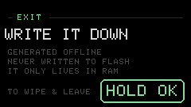
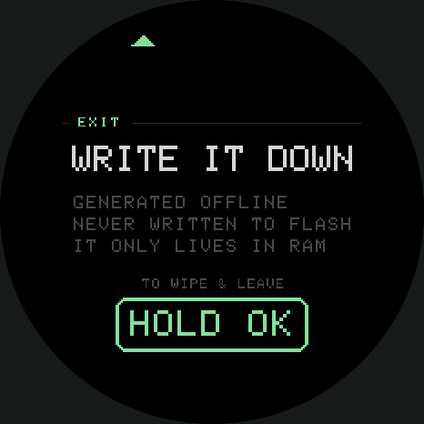
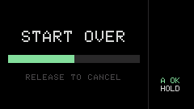
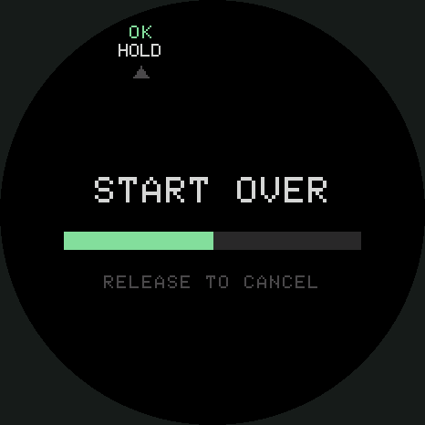

# StickS3 and Waveshare feature comparison

This compares the **current source**: `2.2.0-sticks3.3` and `2.2.0-ws175c.10`.
The Waveshare `.10` increment changes release provenance/version only; its interface and controls match `.9`.
Both compile and pass host checks. Waveshare `.9` was flashed with backup and
readback, then independently ROM-verified; its revised reset visuals still need
physical acceptance. StickS3 `.3` has not been flashed; `.1` remains its last
physically checked build. Waveshare `.8` is the previous device-tested baseline.
Installing an older binary does not provide the changes described here.

[Project hub](../readme.md) · [StickS3 manual](../README-STICKS3.md) · [Waveshare manual](../README-WAVESHARE175C.md) · [Differences from BitMaker](fork-differences.md)

## Buttons: what changed and what did not

**Waveshare's approved button mapping is unchanged.** The larger PWR button
selects in menus and advances through generated seed pages. The smaller BOOT
button changes a menu choice and goes backward through generated pages.
StickS3 now follows that same pattern with front A and side B respectively.
No physical buttons were swapped on Waveshare.

| Action | StickS3 | Waveshare, buttons across the top |
| --- | --- | --- |
| Change menu/word-count choice | Small side B | Small right BOOT |
| Select menu/word-count choice | Big front A | Big left PWR |
| Enter Heads / bit 1 | B | BOOT |
| Enter Tails / bit 0 | A | PWR |
| Cycle die face | B | BOOT |
| Record die face | A | PWR |
| Next generated page | A | PWR |
| Previous generated page | B | BOOT |
| Discard unfinished input | Hold A three seconds | Hold PWR three seconds |
| Clear at Write It Down / Exit | Hold A three seconds | Hold PWR three seconds |

Normal taps take effect on release. During input or at Exit, the hold warning
appears after about 1.2 seconds. Release during the warning to cancel; that
release does not also enter an input or navigate. Continue holding to three
seconds to clear and return to the mode menu. A normal short forward tap on
Exit wraps to words; backward returns to Watch Only.

## Complete current feature list

There is no intentional user-facing feature unique to one of these two ports.
The following features and limitations apply to **both**:

| Area | Shared behavior |
| --- | --- |
| Startup | Seeder splash, BitMaker/Lunaticoin credits and powered-by artwork; SOVEREIGN spelled correctly; device-specific version/build label |
| Main menu | Coin and Dice choices; selection highlight and button indicators |
| Word count | 12 or 24 words; a fresh mode selection initially offers 12 |
| Coin capture | 128 or 256 recorded flips; Heads=1, Tails=0, first bit is most significant; original progress/entropy preview |
| Dice capture | 50 or 99 recorded six-sided rolls; choose 1–6, accept, reset face to 1; three recent-roll values, count and progress |
| Entry correction | Whole-entry restart via three-second hold; no per-result undo/editor |
| Entry reset warning | START OVER, original-style filling bar, RELEASE TO CANCEL; release preserves input |
| Generation | Automatically begins after the required final input; original generating message |
| Seed calculations | Original BIP39 list/checksum; coin bits directly; SHA-256 of ASCII dice digits, first 16 bytes for 12 words or all 32 for 24 |
| Mnemonic pages | Numbered words 1–12; extra page 13–24 only for 24 words |
| First Address | Complete lowercase BIP84 receiving address, five-character green/white checkerboard groups, reversing the starting color on each row, equivalent uppercase Bech32 QR, inline title/counter; no displayed derivation path |
| Address derivation | Bitcoin mainnet, empty BIP39 passphrase, `m/84'/0'/0'/0/0`; the hidden path is unchanged |
| Entropy page | Original 16/32 entropy bytes in hexadecimal; original byte-color alternation |
| Export | QR of the complete space-separated mnemonic text; same revised caption and page counter |
| Watch Only | Bare account zpub at `m/84'/0'/0'`; same explanation, page counter and separate master-fingerprint label/value |
| QR borders | Two white modules per side; integer module sizes; no antialiasing of QR cells. This is reduced from the usual four-module quiet zone; host decoding passes, physical-camera compatibility is not guaranteed |
| Compact QR | No reachable CompactSeedQR page on either current port; Export is not numeric SeedQR or binary CompactSeedQR |
| Write It Down | Original backup reminder, wipe legend and outlined HOLD OK control while idle |
| Exit reset warning | Reuses that device's input START OVER / RELEASE TO CANCEL warning, including the native text/bar geometry; three-second total hold, cancellable release |
| Page navigation | Big/select forward, small/move backward; wraps; normal taps do not erase |
| Palette | Original green `0x86F3`, original white/grey text colors, black background; address groups use green and bright white |
| Operation | Two physical buttons; no touch, motion or microphone control; no sound, haptics or accessory requirement |
| Networking | No Wi-Fi/Bluetooth initialization, networking, OTA update or online account |
| Persistence | No intentional seed storage; clear overwrites application-owned fields; no existing-seed restoration |
| Power UI | Fixed brightness setting, no brightness menu, automatic dimming, inactivity sleep or motion wake feature |
| Scope | Seed generation and export, not balance retrieval or transaction signing; no BIP39 passphrase editor, existing-seed import, numeric SeedQR, descriptor/PSBT/multisig export |
| Hardware trust | Neither port provisions Secure Boot or burns eFuses; flashing another project remains possible |

The sequence for **12 words** is: **Mnemonic 1/5 → First Address 2/5 →
Entropy 3/5 → Export 4/5 → Watch Only 5/5 → Write It Down**.
For **24 words**, there are two mnemonic pages, so Address is 3/6, Entropy 4/6,
Export 5/6 and Watch Only 6/6. Write It Down remains an unnumbered Exit page.

Export wording on both ports, with line wrapping adapted to the screen:

```text
12 SEED WORDS  (or 24 SEED WORDS)
KEEP THIS QR PRIVATE.
SCAN ONLY WITH AN OFFLINE SIGNING DEVICE.
NEVER PHOTOGRAPH IT.
```

Watch Only wording on both ports:

```text
ACCOUNT PUBLIC KEY
USE THIS KEY TO VIEW WALLET ACTIVITY.
IT CANNOT SPEND BITCOIN.
FINGERPRINT
<master fingerprint>
```

## Remaining differences in either direction

These differences are intentional hardware/layout adaptations, not extra
seed-generation or export features.

| Area | StickS3 | Waveshare 1.75C |
| --- | --- | --- |
| Screen | Landscape 240×135 LCD | Circular 466×466 AMOLED |
| Composition | Original rectangular rows, right-side button rail and side-by-side QR/caption | Enlarged/repositioned content inside the circle, top-button indicators and QR above caption; original rectangular divider removed |
| Font rendering | M5GFX backend, upstream-compatible font selection/native-size glyphs | Frozen upstream TFT_eSPI glyph rasterizer, enlarged with discrete pixel scaling; wrap and spacing differ |
| Brand artwork | Native upstream bitmap sizes; only final N/G letter pixels exchanged to correct SOVEREIGN | Artwork regenerated from upstream high-resolution masters, cropped/cleaned/downsampled for sharper larger display; original final letters exchanged before downsampling |
| Address arrangement | Two groups per line (10 characters); five lines for a 42-character address | Three groups per line (15/15/12 characters); three lines |
| Address QR | 116×116 white panel at native resolution, 100×100 pattern | 290×290 white panel, 250×250 pattern |
| Other QR sizes | Largest whole-module panel fitting the 135-pixel screen height | Whole-module panel sized to stay inside the circular display and leave caption space |
| Button markings | A / B in screen hints, physical front/side buttons; separate hardware power key | OK / MOVE-style top indicators, physical PWR / BOOT; PWR also has board-level power behavior |
| Orientation | Landscape layout, front button to its right | Both buttons across the top, larger PWR left and smaller BOOT right; rotated framebuffer |
| Display response | M5GFX LCD update and backlight control | Arduino_GFX canvas and full-frame QSPI AMOLED transfer; fixed register brightness |
| Brightness/color | LCD setting 128/255 | AMOLED setting 128/255; equal numbers do not imply equal luminance or calibrated colors |
| Board setup | M5Unified/M5GFX; unused peripherals disabled; M5 board-identification hint may update NVS | Direct panel/button setup; touch held in reset, amplifier off, microphone/IMU shutdown; factory power/charging configuration preserved |
| Storage/install | 8MB flash; complete device-specific image, app at `0x10000`; browser path skips mutable NVS | 32MB flash; guarded app-only install at `0x200000` in the existing seven-partition factory map; other factory partitions preserved |
| Memory copies | Display/library/stack buffers specific to M5 backend | Additional full-frame and upstream-reference sprite buffers; complete RAM scrubbing unverified on both |
| Hardware power | M5's separate power/reset key and built-in battery | Waveshare PWR/AXP2101 behavior and battery option; neither port has a Seeder battery gauge or qualified runtime estimate |
| Version | `2.2.0-sticks3.3` | `2.2.0-ws175c.10` |

Physical brightness, refresh latency, button/power timing, camera scanning and
battery behavior are not claimed to be identical. The exact programmed image
must be checked separately from the current source or screenshots.

## What changed from the previous two builds

| Previous build | Changes in current source |
| --- | --- |
| StickS3 `.1` → `.3` | Removes Compact QR; changes generated-page directions to big A forward/small B backward; adds Export/Watch Only counters and matching captions; removes displayed address path, enlarges/repositions address QR and keeps five-character green/white address groups; changes Exit from the old ~1.2-second immediate action to the shared cancellable three-second warning; retains outlined HOLD OK while idle; corrects splash spelling; alternates address-group starting colors by row |
| Waveshare `.8` → `.9` | Restores the original-style outlined HOLD OK idle control and wipe legend; replaces the inline reset line with the same START OVER / RELEASE TO CANCEL screen used during input. **Menu, capture and seed-page button directions are unchanged** |

Retained CompactSeedQR helper/encoder code and test fixtures do not expose that
screen in either current workflow. Legacy LilyGO targets retain their earlier
rectangular fork behavior and are outside this two-device parity comparison.

## Reset screens

Native production-code renders using public test data; not device photographs.
Each port reuses its own input-warning geometry at Exit.

| StickS3 | Waveshare 1.75C |
| --- | --- |
|  |  |
|  |  |

## Verification and limits

Production button-detector/workflow tests run with each board's actual pin and
active-level definitions. They check 12/24-word page ordering, counters,
forward/back navigation, generation, release-to-cancel, hold-to-confirm, suppression
of accidental input during holds and application-field clearing. Native renders
check that each port's input and Exit reset warnings are pixel-identical.
Independent calculation vectors and QR checks cover the underlying data.

These checks do not establish physical scan reliability, private-entropy quality,
complete RAM erasure, battery runtime or an independent security audit. A
source-level feature match is not evidence that an older connected device was
updated.
