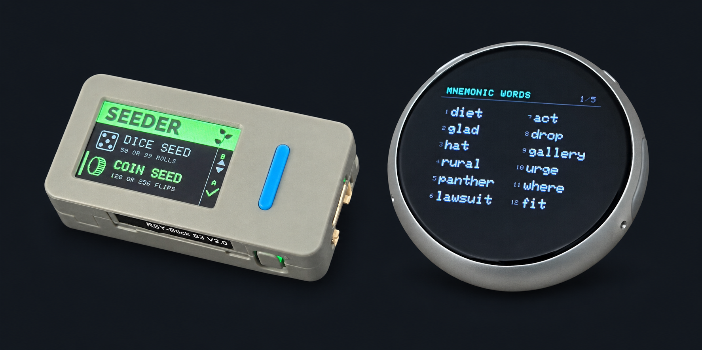
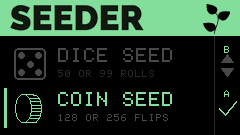
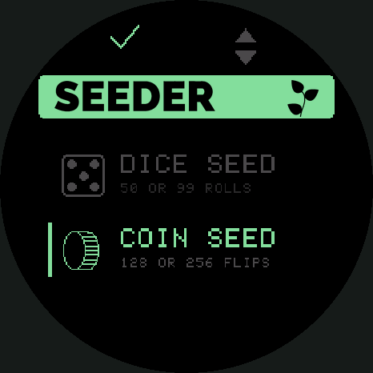
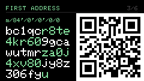
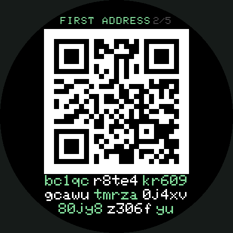
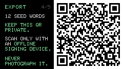
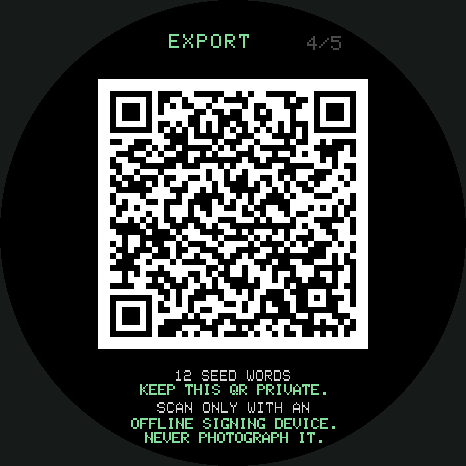

# Seeder Fork

**A two-button, offline Bitcoin seed generator for M5Stack StickS3 and Waveshare AMOLED 1.75C.** Enter your own coin flips or dice rolls, write down the resulting 12 or 24 BIP39 words, check the first receiving address, and export to a compatible offline signing device or watch-only wallet.



*Two supported devices: StickS3 on the left; Waveshare 1.75C on the right.*

Seeder was created by **[BitMaker](https://github.com/BitMaker-hub/Seeder)** from an idea by **Lunaticoin**. This community fork builds on their Seeder v2.2.0, retains the original credits and [MIT license](LICENSE), and adds hardware ports and interface adaptations. It does not generate random entropy for you: the physical coin or die supplies the input.

[Documentation hub](docs/README.md) · [StickS3 manual](README-STICKS3.md) · [Waveshare manual](README-WAVESHARE175C.md) · [Flashing guide](docs/flashing.md) · [Credits](docs/credits.md)

## Choose your device

| Device | Identify it before buying or flashing | Manual |
| --- | --- | --- |
| **M5Stack StickS3 / K150** | Rectangular 1.14-inch LCD; ESP32-S3; 8MB flash and 8MB PSRAM. Not StickC, StickC Plus or StickC Plus2. | [StickS3 manual, controls and installation](README-STICKS3.md) |
| **Waveshare ESP32-S3-Touch-AMOLED-1.75C** | Round 1.75-inch 466×466 AMOLED in the CNC aluminum enclosure; 32MB flash and 8MB PSRAM. The **C** suffix matters. | [Waveshare manual, controls and installation](README-WAVESHARE175C.md) |

Buy the exact models from the [M5Stack official StickS3 shop](https://shop.m5stack.com/products/m5sticks3-esp32s3-mini-iot-dev-kit) or the [Waveshare official 1.75C shop](https://www.waveshare.com/esp32-s3-touch-amoled-1.75c.htm). The manuals explain battery options, hardware identity and the two interfaces.

## Start here

1. Open your device's manual and identify its buttons and firmware image.
2. Follow the [flashing guide](docs/flashing.md). StickS3 uses its own complete image; Waveshare preserves its factory map and installs only the app at `0x200000`.
3. Try the complete workflow with public test data first, then read [Using Seeder](docs/using-seeder.md) and [Security](SECURITY.md) before entering private entropy.

**[Flash from your browser](https://xn--sg8hhb.ws/flasher/)**: select your exact board and Seeder, review the version, then follow the USB connection, recovery-backup and installation steps. Desktop Chrome/Edge or another Web Serial browser is required. The [terminal flashing guide](docs/flashing.md) remains available for independent builds and ROM verification.

## What it does

| Choice | 12-word seed | 24-word seed |
| --- | --- | --- |
| Coin input | 128 flips | 256 flips |
| Dice input | 50 rolls of a six-sided die | 99 rolls of a six-sided die |

After generation, review the numbered words, first BIP84 receiving address, entropy bytes and export pages. Both devices have the same review-page sequence. **Export** contains the seed and permits spending; **Watch Only** contains the account public key and cannot sign transactions, but exposes wallet activity. [Every page and payload](docs/using-seeder.md#pages-and-qr-payloads) is explained in the shared guide.

The firmware does not initialize Wi-Fi or Bluetooth and does not intentionally save seed material. It uses an empty BIP39 passphrase; it has no passphrase-entry or existing-seed import screen. Exit clears application-owned fields, but complete erasure of every library, stack or display-buffer copy has not been verified. See [the security model](SECURITY.md).

## Current interface

| StickS3: green rectangular interface | Waveshare: green round interface |
| --- | --- |
|  |  |
|  |  |
|  |  |
|  |  |

*These screenshots are software renders of production UI code using public test fixtures, not device photographs or camera-scan evidence. Never use pictured test seeds for funds.*

[Device feature comparison](docs/device-parity.md) · [Full Waveshare gallery and original comparisons](docs/screenshots.md) · [Artwork and photograph provenance](docs/artwork.md) · [All differences from upstream](docs/fork-differences.md)

## Validation and development

**Current source: `2.2.0-sticks3.2` and `2.2.0-ws175c.9`.** The Waveshare button mapping is unchanged; StickS3 now follows it. These updates align page order, controls, captions and counters, remove the StickS3 Compact QR page, correct its splash spelling and give both ports the original-style HOLD OK box with the shared cancellable reset warning. They have build/host-test coverage; these exact builds have not yet been flashed or physically accepted.

The last physically tested StickS3 build is `2.2.0-sticks3.1` (original green palette restored); its complete image was flashed and ROM-verified, and the green menu/both buttons were physically confirmed. Waveshare `2.2.0-ws175c.8` was flashed and readback-verified; it retains the physically accepted .7 layout with a splash-spelling and version-label correction. Full physical input-flow, camera scanning, battery/power qualification and independent security auditing remain separate work.

All four build targets compile: `sticks3`, `waveshare175c`, and the retained upstream LilyGO `tdisplay` / `tdisplay-s3` targets. Compiling a target does not establish physical validation for that board. The firmware remains native C/C++; the port does not change the original coin/dice seed calculations. Independent host checks cover 78 public deterministic calculation vectors, QR payloads and the device-specific interfaces. See each manual for the actual evidence and limits.

[Build and flash](docs/flashing.md) · [Calculation test vectors](TESTVECTORS.md) · [Crypto test instructions](tests/crypto/README.md) · [Source license](LICENSE) · [Third-party notices](THIRD-PARTY-NOTICES.txt)

## Credits

- **BitMaker and Lunaticoin:** original Seeder design, idea, software, graphics and documentation; copyright and MIT terms remain intact.
- **This fork:** StickS3 and Waveshare board support, added address QR and interface/export adaptations, documented in [fork differences](docs/fork-differences.md).
- **SeedSigner:** the [CompactSeedQR specification](https://github.com/SeedSigner/seedsigner/blob/dev/docs/seed_qr/README.md#compactseedqr-specification) used by earlier StickS3 builds and retained encoder tests. The current StickS3/Waveshare page sequence omits Compact QR.
- **Dependency authors:** uBitcoin, TFT_eSPI, M5Stack, Arduino_GFX and Espressif; see [the preserved notices](THIRD-PARTY-NOTICES.txt).

The original Spanish Seeder documentation and its credits are preserved below.


## Original project documentation

<details>
<summary>BitMaker's original documentation and credits</summary>

---

Un dispositivo DIY que te permite crear tus propias semillas de Bitcoin en cuestión
de segundos, sin depender de nadie ni de nada para salvaguardar tus fondos.

Con la SEEDER puedes hacer el proceso **semilla moneda**, generar entropía con
**dados**, y **calcular la última palabra de tu semilla sin esfuerzo**, además de
exportarla mediante un código QR.

Todo ello gracias a la genial idea de @Lunaticoin y mi trabajo.


## La SEEDER no genera entropía

Esto es lo que hace distinta a la v2: **el dispositivo no tiene generador de números
aleatorios**. La entropía la pones tú, con una moneda o con un dado, y la SEEDER se
limita a hacer las cuentas de BIP39 delante de ti.

Y esas cuentas las puedes rehacer por tu lado. La SEEDER te enseña la entropía en
hexadecimal en la pantalla `Entropy (hex)`. Con ese hex y cualquier herramienta BIP39
offline obtienes exactamente las mismas palabras. Si no coinciden, tira el aparato.

| Modo | Entradas | Entropía |
|---|---|---|
| Moneda | 128 tiradas (12 palabras) / 256 (24) | los bits, tal cual, sin pasar por ningún hash |
| Dado   | 50 tiradas (12 palabras) / 99 (24)   | `SHA-256` de los dígitos en ASCII |

El modo dado usa el mismo esquema que la Coldcard, así que puedes verificarlo desde
un terminal:

```bash
printf '3141592653...' | sha256sum
```

Con 24 palabras se usan los 32 bytes del hash; con 12 palabras, los **16 primeros**
(los 32 primeros caracteres del hex). Es lo mismo que hace la Coldcard.

Y el modo moneda no aplica ningún hash: los bits que lanzas **son** la entropía. Eso
te permite además meter una entropía que ya tengas y dejar que la SEEDER te calcule
la última palabra con su checksum.

## Requisitos

Cualquiera de las dos placas:

| Placa | Pantalla | Binario |
|---|---|---|
| LilyGO TTGO T-Display (ESP32) | 240x135 | `seeder-tdisplay-merged.bin` |
| LilyGO T-Display-S3 (ESP32-S3) | 320x170 | `seeder-tdisplay-s3-merged.bin` |

Y un cable USB-C.

Opcionalmente admite una LiPo por el conector JST. La placa no trae interruptor,
pero **sí se puede apagar por firmware**: cómo hacerlo, y qué esperar del consumo
en reposo, está en [HARDWARE.md](HARDWARE.md).

## Instalación

Todo sale de la [última release](https://github.com/BitMaker-hub/Seeder/releases).
Hay dos caminos: uno cómodo y otro comprobable. Elige según lo que te juegues.

### Vía rápida — desde el navegador

Descarga `seeder-firmware-merged.bin` y flaséalo con
[esptool-js](https://espressif.github.io/esptool-js/) en el offset **0x0**.
Un solo archivo, nada que instalar.

> Cómodo, pero estás confiando en que la página te sirvió el binario correcto.
> Para una semilla de verdad, haz también la comprobación de abajo.

### Vía manual — desde el terminal, y verificable

Descarga la release entera, incluido el `SHA256SUMS`, y comprueba que lo que te
has bajado es lo que la CI publicó:

```bash
sha256sum -c SHA256SUMS
```

Flashea:

```bash
esptool.py --chip esp32 --port /dev/ttyUSB0 --baud 460800   write_flash -z 0x0 seeder-firmware-merged.bin
```

Y comprueba que el chip contiene de verdad ese binario:

```bash
esptool.py --port /dev/ttyUSB0 --no-stub verify_flash 0x0 seeder-firmware-merged.bin
```

En Windows el puerto es `COM3` o similar. Ese último paso es el que importa y
está explicado en [SECURITY.md](SECURITY.md): con `--no-stub` la aplicación de la
SEEDER ni se ejecuta, responde el bootloader de la ROM del chip, así que un
firmware manipulado no puede mentir sobre lo que hay en la flash.

## Compilar desde fuente

```bash
pio run -e seeder
```

Las librerías (`uBitcoin`, `TFT_eSPI`) van fijadas dentro de `lib/` a propósito:
un generador de semillas debe compilar igual hoy que dentro de cinco años.

## Controles

Dos botones y nada más. **MOVE** es el de arriba y **OK** el de abajo.

| Dónde estás | MOVE | OK |
|---|---|---|
| Menú y elección de palabras | cambia la opción | acepta |
| Lanzando la moneda | cara | cruz |
| Tirando el dado | 1 → 6 | acepta la tirada |
| Leyendo la semilla | página siguiente | página anterior |
| Última página (`Exit`) | vuelve a la primera | mantener para salir y borrar |

Durante la captura, **mantener OK tres segundos vuelve al menú** y borra lo que
llevaras metido: si te has equivocado en la tirada 40 de 99 no hace falta
desenchufar el aparato. A los ~1,2 s aparece el aviso con una barra que se llena;
si sueltas antes, esa pulsación no cuenta como cara, cruz ni tirada.

## Llevarla a Sparrow

La SEEDER exporta dos QR distintos, y **no dan el mismo poder**:

| Pantalla | Qué lleva | Quien lo escanee |
|---|---|---|
| `Export` | las 12 o 24 palabras | **puede gastar** |
| `Watch only` | el zpub de cuenta | sólo ve el saldo |

**Sólo lectura** — es el que puedes escanear con el ordenador delante:

1. `File > New Wallet…`, le pones nombre y `Create Wallet`.
2. Se abre en *Settings* con **Single Signature** y **Native Segwit (P2WPKH)**
   ya puestos. Déjalos: son justo los de la SEEDER.
3. En *Keystores*, el icono del **ojo**, `Watch Only Wallet`.
4. En la fila `xpub:`, el botón de la **cámara**, y le enseñas el QR.
5. La SEEDER te muestra la huella maestra en esa misma pantalla. Cópiala en
   *Master fingerprint*, que Sparrow lo deja en `00000000` y ese cero acaba
   metido en cada PSBT que construya.
6. `Apply`.

> El botón de QR que hay junto al campo `Descriptor:` **no** sirve para esto:
> con una clave suelta no hace nada y no avisa. Tiene que ser el de la fila
> `xpub:`.

**La semilla**, si de verdad la quieres importar: `BIP39 keystore`, la **flecha
del desplegable** junto a `Use 24 Words`, y ahí dentro `Scan QR…`. No hay botón
visible y no está documentado. Necesita Sparrow **1.7.7 o posterior**.

Pero piénsatelo: meter las palabras en un ordenador conectado tira por tierra
todo lo demás. Para mirar el saldo te basta el zpub.

## Verificación

No te fíes de la SEEDER: compruébala. La pantalla `Entropy (hex)` te enseña los
bytes de los que salieron tus palabras, y con ese hex y cualquier herramienta BIP39
**offline** puedes rehacer las cuentas. Si no coinciden, no uses el aparato.

Hazlo con **tu propia entropía**, no con los vectores publicados: un firmware
malicioso reconoce las tiradas de prueba y se porta bien sólo ahí.

El modelo de amenazas completo, y qué no cubre, está en [SECURITY.md](SECURITY.md).

> La semilla nunca sale del dispositivo ni se escribe en flash: sólo vive en RAM y
> desaparece al desconectarlo. El firmware tampoco imprime nada por el puerto serie.

## TUTORIAL

Tutorial completo en YouTube:

[](https://youtu.be/2K7ztWxtyY8)


</details>
